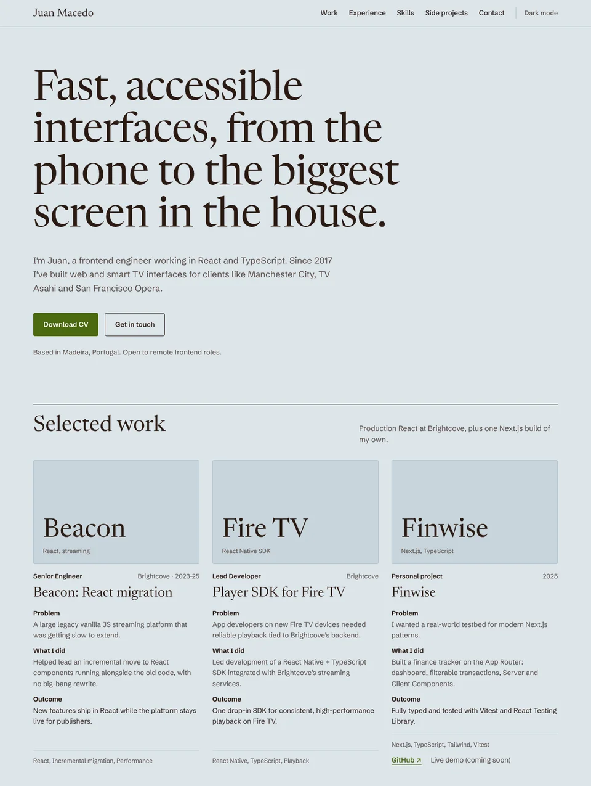

# Portfolio

My personal portfolio: a single-page site aimed at frontend hiring, with selected work, experience, skills, a corner for side projects and a bit about me.

**Live site:** [aspherioth.github.io/portfolio](https://aspherioth.github.io/portfolio/)



## Learning Focus

This project is designed to deepen understanding of modern web development through hands-on practice. The main focus areas include:

- **HTML5 + CSS3** – Semantics, accessibility, responsiveness, cross-browser compatibility
- **React + TypeScript** – Component-driven development with typed props and state
- **Chakra UI** – Flexible and accessible UI components, themed with custom design tokens
- **Vite** – Fast and efficient development environment
- **Tooling and workflow** – Linting, formatting, bundle analysis and CI/CD with GitHub Actions

## Features

- **Sections**: hero, selected work (case-study cards), experience, toolbox, side projects, about and contact
- **Downloadable CV**: served from `public/`
- **Light and dark mode**: follows the system setting, with a toggle in the navigation
- **Responsive design**: mobile-first layout; the nav keeps the key links on small screens and highlights the section you're reading
- **Reduced motion**: entrance animations, carousel transitions and smooth scrolling switch off when the system asks for less motion
- **Custom theme**: the "Ice & Chocolate" palette, fonts and semantic tokens defined in `src/theme.ts`
- **Lean bundle**: only the Chakra UI recipes the site uses are registered

## Tech Stack

- **Framework**: React 19 + TypeScript
- **Build tool**: Vite 7
- **Styling**: Chakra UI v3 (with Emotion), `next-themes` for colour mode
- **Fonts**: Fontsource (Newsreader, Schibsted Grotesk)
- **Code quality**: ESLint 9 (flat config) + Prettier
- **Deployment**: GitHub Pages via GitHub Actions

## Getting Started

You'll need Node.js 24 (the version is pinned in `.nvmrc`, so `nvm use` picks it up).

```bash
npm ci
npm run dev
```

The dev server runs at `http://localhost:5173/portfolio/`. The `/portfolio/` path matches where GitHub Pages serves the site.

### Scripts

| Script              | What it does                                                        |
| ------------------- | ------------------------------------------------------------------- |
| `npm run dev`       | Starts the Vite dev server with hot reload                          |
| `npm run build`     | Builds the production site into `dist/`                             |
| `npm run preview`   | Serves the built `dist/` locally to check the production build      |
| `npm run analyze`   | Builds and opens a bundle size report (`stats.html`, not committed) |
| `npm run lint`      | Checks the whole project with ESLint                                |
| `npm run typecheck` | Type-checks the project with TypeScript                             |
| `npm run lint:fix`  | Fixes what ESLint can fix automatically                             |
| `npm run format`    | Formats every file with Prettier                                    |
| `npm run fix`       | Runs `lint:fix` and then `format`                                   |

## Project Structure

```
src/
├── assets/        Images (portrait, side project screenshots)
├── components/    Page sections (Hero, Experience, Toolbox, About, Contact, ...)
│   ├── cards/     Work and side project cards, and their media carousel
│   └── ui/        Chakra UI snippets (colour mode)
├── data/          Site content: projects, experience, toolbox and links
├── hooks/         useActiveSection for the nav highlight
├── pages/         Page layouts (Home)
├── theme.ts       Chakra UI system: tokens, semantic colours and recipes
├── App.tsx        Providers and top-level layout
└── main.tsx       Entry point
```

Imports can use the path alias `@/`, which points into `src/` (configured in `tsconfig.json`).

## Deployment

Every push to `main` builds the site and deploys it to GitHub Pages (`.github/workflows/deploy.yml`). Before building, the workflow runs lint and the type check, so a lint error or type error stops the deploy. Pull requests run the same checks and build without deploying, so a green check on a PR means the site will build once it's merged.

## License

This project is open source and available under the [MIT License](./LICENSE).
